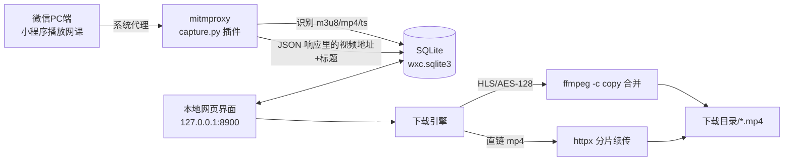

# 微信小程序网课 → 电脑本地 下载器（wxc）

## 1. 目标

把「学校微信小程序里的网课视频」保存到 Windows 电脑本地，可离线观看。
输入 = 学生在微信 PC 客户端里**自己已购/已选**的课程播放行为；输出 = 本地 mp4/ts 视频文件。

非目标：不破解付费壁垒、不绕过账号权限、不做 DRM 破解（SAMPLE-AES / Widevine 一律明确报错）。
仅用于本人已获授权的课程离线学习，**不要再分发**。

## 2. 为什么选「本地代理抓包」方案

小程序视频地址只有在播放时才由服务端下发（带 token / 时效签名），无法静态推导；且学校自建平台没有公开 API。

| 方案 | 可行性 | 结论 |
|---|---|---|
| 反编译小程序包找接口 | 需小程序包 + 破解，版本一更新就废 | ✗ |
| 手机抓包 | 微信安卓端不信任用户级 CA，基本抓不到 | ✗ |
| **PC 微信 + mitmproxy 本地代理** | Chromium 内核，走系统代理 + 系统根证书 | ✓ 选它 |
| mitmproxy `--mode local`（WinDivert） | 免设代理，但需管理员权限 | ✓ 备用手段 |

链路：`微信小程序播放 → 系统代理(127.0.0.1:8899) → mitmproxy 插件识别媒体请求 → 写入 SQLite → 下载引擎(ffmpeg/httpx) → 本地文件`。



## 3. 里程碑

- **M1 环境**：venv + mitmproxy/fastapi/httpx；`wxc doctor` 自检 ffmpeg、端口、CA 证书是否装进系统根存储。
- **M2 抓包层**：`wxc capture` 起 mitmdump；媒体识别、去重、HLS 分片降噪、JSON 内嵌地址与标题提取、按 host 记录可重放请求头。
- **M3 下载引擎**：HLS→ffmpeg 合并（自动带 Referer/Cookie，支持 AES-128）；直链→httpx 支持 Range 断点续传；进度写库；可取消；失败重试与明确报错。
- **M4 界面**：FastAPI + 单页 HTML。捕获列表、批量下载、进度条、改名、忽略/删除、手动粘贴地址、一键开关系统代理、打开下载目录。
- **M5 自测**：本地起 HTTP 服务 + 生成 AES-128 测试 HLS 与测试 mp4，模拟小程序请求走代理 → 验证「抓包→识别→下载→合并→ffprobe 校验时长」。无需真实微信即可端到端验证。

## 4. 目录结构

```
weixin-class/
├─ PLAN.md / README.md / requirements.txt
├─ wxc/
│  ├─ config.py      路径、端口、ffmpeg/mitmdump 探测
│  ├─ store.py       SQLite（媒体条目、host 请求头、设置、分片计数）
│  ├─ detect.py      媒体类型识别 + JSON/HTML 内嵌地址与标题提取
│  ├─ capture.py     mitmdump 插件（独立进程，写库）
│  ├─ downloader.py  ffmpeg/HLS + httpx 直链，线程池、进度、取消
│  ├─ proxy.py       Windows 系统代理开关（HKCU + WinINet 刷新）
│  ├─ webui.py       FastAPI 接口 + 静态页
│  └─ cli.py         命令行入口
├─ static/index.html 单页界面（无构建步骤）
└─ .data/            库、下载文件、证书（已 gitignore）
```

## 5. 已知风险与对策

| 风险 | 对策 |
|---|---|
| 微信不信任本地 CA | `wxc cert install` 装进当前用户「受信任的根证书颁发机构」；`doctor` 复检 |
| 微信不吃系统代理 | 备用 `--mode local`（管理员运行）；或把手机/浏览器流量指到 8899 |
| 视频是 SAMPLE-AES / DRM | 明确报「不支持」并停止，不做破解 |
| 链接带时效签名，抓完放几小时就失效 | 报错文案直接提示「重新播放该课时再抓一次」；条目支持覆盖刷新地址 |
| 下载请求回环到自己的抓包代理 → 证书校验失败 | httpx：`trust_env=False` + 系统证书存储；ffmpeg：剥掉 `*_proxy` 环境变量（实测 `-http_proxy ""` 只挡清单，分片和 AES 密钥仍会走代理） |
| 分片挂在另一台 CDN 主机上，按同目录判分片会漏 | 解析清单得到分片目录并持久化（`seg_prefix`）；再从清单 URL 抽「流 ID」并持久化，**播放器接着上次播放、不重新拉清单时也能认出**（启动时从库里已有清单回填流 ID） |
| 单独下载 .ts 分片 = 加密原文，播放器报「文件已损坏」 | 下载侧硬防护：分片若属于已抓到的同一流 → 拒绝并自动忽略，界面直接把按钮换成「下载整节课」 |
| 同一节课抓到多个清晰度，不知道下哪个 | 从地址解析清晰度显示在列表、并写进文件名；下数字最大的 |
| 大视频撑爆内存 | mitmproxy `stream_large_bodies=512k`，>512KB 的响应体直接透传不缓存 |

## 6. 验收标准

1. `wxc doctor` 全绿（ffmpeg / 端口空闲 / CA 已装）。
2. 走代理播放测试 HLS，界面出现条目，标题从 JSON 中正确提取。
3. 点下载 → 生成 mp4，`ffprobe` 时长与源一致，可播放。
4. 直链 mp4 中断后续传不重下。
5. 取消、删除、忽略、改名、批量下载均生效。
