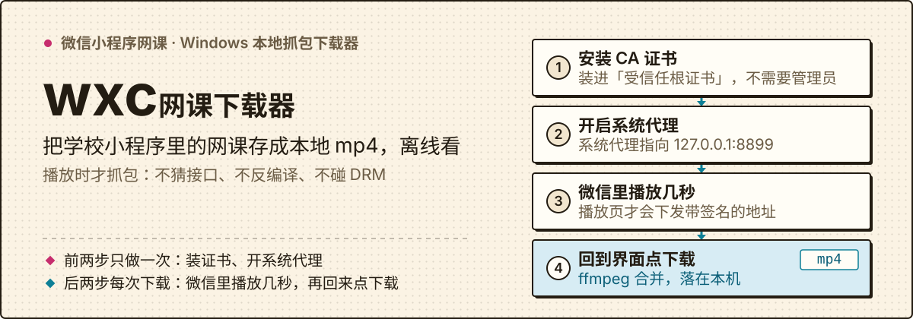
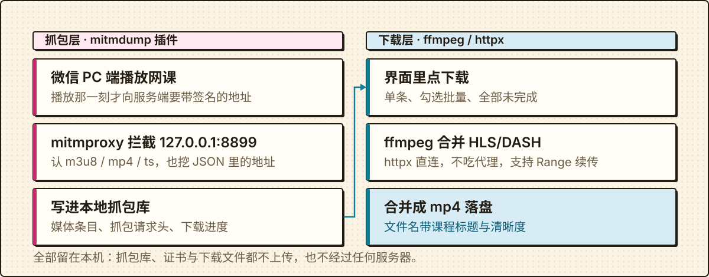

# wxc · 微信小程序网课 → 电脑本地下载器

<p align="center">
  
</p>

把学校微信小程序里的网课视频抓到 Windows 电脑上，存成本地 mp4 离线看。给**自己已选修 / 已购**课程的学生用，单机运行：抓包库、证书和下载文件都留在你自己的电脑上。界面在 `http://127.0.0.1:8900`。

两条路：**下载即用** → 从 [Releases](https://github.com/A-510/wxc/releases/latest) 下载 `wxc.exe` 双击；**从源码跑** → `scripts\start.bat`（改代码走这条）。

> 仅用于**自己已选修/已购**课程的离线学习，别外传、别二次分发；不做任何 DRM 破解（SAMPLE-AES 会直接报错停止）。

## 下载即用：双击 `wxc.exe`

到 [Releases](https://github.com/A-510/wxc/releases/latest) 下载 `wxc.exe`（单文件，约 10.6 MiB），放进任意目录双击即可；自己打包则是 `dist\wxc.exe`。

第一次打开，它按 ① 电脑环境 → ② ffmpeg → ③ 依赖库 的顺序自检这台机器，进度就打在同一个窗口里：

| 情况 | 它会怎么做 |
|---|---|
| Python 没装、或低于 3.10 | 报错并给出 Python 下载页（可按提示一键打开）；装的时候记得勾选 **Add python.exe to PATH** |
| 没找到 ffmpeg | 有 winget 就直接 `winget install Gyan.FFmpeg`；没有 winget 就打印命令与 gyan.dev 下载页，等你手动装好再来 |
| 依赖库没装 | 在 `.venv` 里跑 `pip install -r requirements.txt`，pip 进度直接显示在窗口里 |

装过东西（依赖或 ffmpeg）之后的正常结局是：**关掉这个窗口，再双击一次 `wxc.exe`**。第二次打开环境已经齐了，它直接进 ④ 启动服务（抓包代理 + 界面）并自动打开浏览器。

| 用法 | 作用 |
|---|---|
| `wxc.exe` | 自检 → 缺什么装什么 → 提示重开 → 再打开就启动 |
| `wxc.exe --check` | 只自检（① 电脑环境 / ② ffmpeg / ③ 依赖库），不装任何东西；退出码 `0` = 可以启动，`1` = 还得补环境 |
| `wxc.exe --repair` | 强制重装依赖 |
| `wxc.exe doctor` / `proxy off` / `dl <url>` | 其余参数原样转给 `wxc.cli`，见下面命令行表 |

- **装在哪**：`%LOCALAPPDATA%\wxc\app`（想换位置设环境变量 `WXC_HOME`）；`wxc.exe` 旁边就是项目源码时，直接用那个目录，不解包。
- **依赖**：装进项目目录的 `.venv`；一次装不上会自动换清华 PyPI 镜像再试一次。
- **不想让它自动装 ffmpeg**：设 `WXC_NO_AUTO_INSTALL=1`，它只打印手动安装说明。
- **自己构建**：`python scripts\build_exe.py`（PyInstaller `--onefile --console`，图标转换需要 Pillow；打包会拒绝收录项目根目录以外的任何路径）。

## 四步主线（第一次用照这个顺序走）

1. **安装 CA 证书** —— 界面点 **安装 CA 证书**：把 mitmproxy 根证书装进「当前用户 → 受信任的根证书颁发机构」，不需要管理员。
2. **开启系统代理** —— 界面点 **开启系统代理**。
3. **在微信 PC 端播放几秒** —— 打开小程序，把要下载的课时**播放几秒**（能听到声音 / 看到画面即可，也可以拖动进度条）。
4. **回来点下载** —— 界面点 **刷新**，列表里会出现条目（标题通常已从课程接口里自动提取）：
   - **下载**：单条下载；勾选后 **下载选中**，或 **下载全部未完成** 批量下。
   - 同一节课常会抓到多个清晰度（列表里显示 `1280x720 / 960x540 / 640x360`）：**下最高的那个**就行，下载文件名会自动带上清晰度，方便你删掉多余的。
   - 文件名默认用课程标题，直接点标题可改名；**播放** 可在浏览器里预览，**定位** 打开文件所在目录。

**下完记得点 关闭系统代理**（否则断网 / 微信异常时先检查这里）。用 Ctrl+C 停 `wxc start` 时会自动关闭它并还原你原来的代理设置；直接关窗口来不及还原的话，下次运行 `wxc proxy off`（或界面点关闭系统代理）。

## 原理：抓包一层，下载一层

播放时小程序才会向服务端要带签名的视频地址，所以抓包必须发生在**播放的那一刻**，不用猜接口、不用反编译：
抓包层是独立的 mitmdump 插件进程，把识别出的地址与请求头写进 `.data/wxc.sqlite3`；下载层从库里的条目取任务——
HLS / DASH 交给 ffmpeg 合并，直链走 httpx 并支持 `Range` 续传，最后合并成一个 mp4。

<p align="center">
  
</p>

## 从源码跑（改代码走这条）

```bat
scripts\start.bat
```

首次会自动建 `.venv` 并装依赖。等价的手动步骤：

```bat
python -m venv .venv
.venv\Scripts\python.exe -m pip install -r requirements.txt
.venv\Scripts\python.exe -m wxc.cli start
```

浏览器会自动打开 `http://127.0.0.1:8900`。

## 命令行

| 命令 | 作用 |
|---|---|
| `wxc start` | 抓包 + 界面一起启动（推荐） |
| `wxc capture` | 只起抓包代理（`--mode local` 走 WinDivert 透明拦截，需管理员） |
| `wxc ui` | 只起界面（`--no-capture` 不拉抓包进程） |
| `wxc doctor` | 自检：ffmpeg、CA 证书、端口、下载目录 |
| `wxc cert [--install]` | 查看/安装 mitmproxy 根证书 |
| `wxc proxy on\|off\|status` | 开关 Windows 系统代理（关闭时会还原你原本的代理设置） |
| `wxc dl <url> [-t 标题] [-o 输出目录]` | 不起界面，直接下一个已知地址 |

`.venv\Scripts\python.exe -m wxc.cli <命令>` 等价于 `wxc <命令>`。

## 文件位置

```
.data/wxc.sqlite3     抓包库（媒体条目、请求头、进度）
.data/downloads/      默认下载目录（界面里可改）
~/.mitmproxy/         mitmproxy 根证书
```

用 exe 且旁边没有源码时，前两项在 `%LOCALAPPDATA%\wxc\app` 下面。

## 抓不到 / 下载失败怎么办

| 现象 | 原因与处理 |
|---|---|
| 列表一直空的 | ① 没开系统代理；② CA 没装（微信 PC 端走系统证书，装完重启微信）；③ 播放页的视频地址还没请求——多播几秒、换个清晰度或拉动进度条 |
| 微信仍能播放但列表没条目 | 微信不吃系统代理时用 `wxc capture --mode local`（管理员），它直接透明拦截本机流量 |
| 点下载报 `CERTIFICATE_VERIFY_FAILED` / `unable to get local issuer certificate` | 已修：下载一律**直连**，不再被系统或环境代理（包括本工具自己的抓包代理）夹一层；证书用 Windows 系统存储校验。仍报错多半是链接过期：重新播放该课时再抓一次 |
| 列表里一堆 `TS 片`、下下来播放器说文件已损坏 | `.ts` 是 HLS 的**加密分片**（约几秒、未解密），单独保存必然损坏。现在：清单/流 ID 一经识别，分片只计数不入库；老的分片条目点 **清理 TS 分片条目**，或直接点它那行的 **下载整节课**。要下的是 **HLS** 那几行 |
| 同一节课多个清晰度，下哪个 | 下清晰度数字最大的（如 `1280x720`）。注意平台标的清晰度未必等于真实分辨率，可点 **播放** 先看 |
| 点下载报 `HTTP 403 / 401`、`ffmpeg 退出码 1` | 链接带时效签名，抓完放久了会失效：回微信重新播放该课时，刷新后重下（`重下` 按钮）。也可能是播放需要 Cookie，条目已记录抓包时的 Cookie/Referer，重新抓一次即可刷新 |
| 报 `SAMPLE-AES 加密（DRM）` | 平台用了 DRM，本工具不支持也不解密，换平台提供的下载方式 |
| 报 `不是点播播放列表` | 直播/未结束的列表，暂停后再抓 |
| 报 `f4m 清单暂不支持` | Adobe HDS，换清晰度或换课时入口重抓 |
| HLS 下载中断 | `.part` 分片会保留，再点一次下载会带 `Range` 续传；HLS 中断则整段重下 |
| 下载很慢 | 界面里把并发从 2 调高（最高 8），注意别把学校服务器打崩 |

## 自检（不用微信，也不联网）

```bat
.venv\Scripts\python.exe scripts\selftest.py
```

会本地造一个 AES-128 加密的 HLS 和一个 mp4 → 起 HTTP 服务（**分片故意放在另一台「主机」上**，复现真实 CDN 的跨主机分片）
→ 走 mitmproxy 抓包 → 下载合并 → 用 ffprobe 校验时长与字节一致性，并验证跨主机分片降噪、断点续传、
以及**在设置了 `HTTP_PROXY`/`HTTPS_PROXY`（Clash 类工具）时下载仍能直连**。全部 PASS 说明抓包层和下载层都是好的。

## 目录结构

```
wxc/config.py      路径/端口/外部程序探测
wxc/store.py       SQLite：媒体条目、host 请求头、设置、分片计数
wxc/detect.py      媒体类型识别 + JSON 里挖地址与标题
wxc/capture.py     mitmdump 插件（独立进程写库）
wxc/downloader.py  ffmpeg(HLS/DASH) + httpx(直链，支持 Range 续传)、进度、取消、文件名占位
wxc/proxy.py       Windows 系统代理开关（自动记住/还原你原本的代理）、CA 证书安装
wxc/webui.py       FastAPI 接口（页面 + 只读插画路由）
wxc/cli.py         命令行
wxc_launcher.py    exe 启动器（环境自检 → 装依赖 → 提示重开 → 起服务）
static/index.html  单页界面（无构建步骤）
DESIGN.md          界面设计基础（色板/字号/组件/Do&Don't；改界面前先读它）
MOTION.md          动效语言（最小姿态、两个动效原语、reduced-motion 回退）
assets/readme/     README 里的 SVG（hero.svg 首屏、pipeline.svg 两层结构）
design/            设计变更记录（方向预览、动效 QA 与截图）
背景.jpg           界面顶部插画（想换图设 `WXC_ART`）；图标.jpg  exe 图标源文件
scripts/start.bat  一键启动    scripts/selftest.py  离线端到端自检
scripts/build_exe.py  打包 dist/wxc.exe
```
